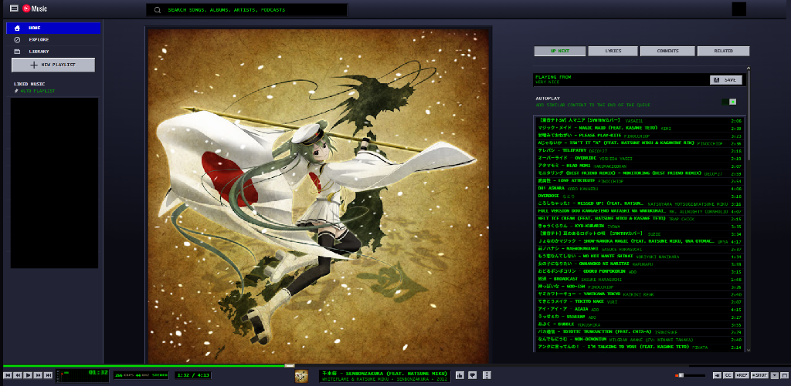

# Winamp YouTube Music Extension

A browser extension that skins **music.youtube.com** like classic **Winamp 2.x** (dark brushed metal, green LCD readouts, blocky beveled buttons, and real-time audio spectrum analyzer) and forces **audio-only** playback by hiding the video and switching the player to "Song" mode.

## Features

-  **Classic Winamp 2.x Aesthetic**: Brushed dark metal panels, green phosphor LCD readouts, and beveled buttons.
-  **Real-time Audio Visualizer**: Web Audio API DSP analyzer with relative dynamic range scaling, 16 non-overlapping frequency bands, peak decay, and configurable smoothing.
-  **Audio-Only Mode**: Hides video feeds and automatically forces the audio stream to save bandwidth and system resources.
-  **Customizable Popup**: Adjust visualizer smoothing (0–100% with Fast, Auto, and Silky presets) and toggle skin or audio-only modes.
-  **Quick Shortcut**: Press `Alt + W` to quickly toggle the skin on and off.

## Install (Opera GX / Chrome / Edge — all Chromium)

1. Open the extensions page:
   - **Opera GX:** go to `opera://extensions`
   - Chrome: `chrome://extensions` · Edge: `edge://extensions`
2. Turn on **Developer mode** (top-right toggle).
3. Click **Load unpacked** and select this folder:
   `C:\Users\User1\winamp-ytmusic`
4. Open <https://music.youtube.com> and play a song.

## Using it

- **Popup** (toolbar icon):
  - **Winamp Skin** toggle
  - **Audio Only** toggle
  - **Visualizer Smoothing** slider (0–100% with Fast, Auto 65%, and Silky presets)
- **Alt + W**: toggle the skin on/off without opening the popup.
- Settings persist and sync across the popup, the shortcut, and open tabs.

## How it works

| Goal | Mechanism |
|------|-----------|
| Skin | `winamp.css` injected over YTM's light-DOM (Shady DOM) selectors, gated on `html.winamp-ytm-on` |
| Remove video | `html.winamp-ytm-audio #song-video` → `display:none` (audio keeps playing), album art forced visible |
| True audio stream | `content.js` clicks the **Song** button in `ytmusic-av-toggle` when a video mode is selected |
| Re-apply on navigation | `MutationObserver` + `yt-navigate-finish` listener |

## Files

- `manifest.json` — MV3 manifest, content script + service worker
- `content.js` — applies classes, forces audio, injects the analyzer
- `winamp.css` — the skin
- `background.js` — handles the Alt+W command
- `popup.html` / `popup.js` — the on/off switches

## If a selector breaks (Google ships YTM changes often)

The fragile, YTM-specific selectors are concentrated in `winamp.css`. Most
likely to drift:

- `ytmusic-player-bar .content-info-wrapper .title / .subtitle` — track LCD
- `tp-yt-paper-slider#progress-bar` / `#volume-slider` — sliders
- `ytmusic-player #song-video` / `#song-image` — video vs. album art
- `ytmusic-av-toggle .song-button` — the audio/video switch (in `content.js`)

Re-grab the live markup (DevTools → Console) and update those selectors. The
gating classes (`.winamp-ytm-on`, `.winamp-ytm-audio`) won't change.
